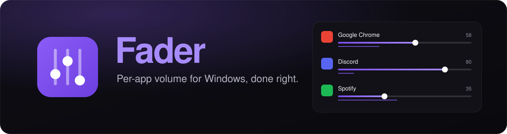

<p align="center"></p>

# Fader

Per-app volume for Windows 10/11 that is actually quick to use, plus a start level that stops
apps from launching too loud. One hand on the mouse, no key held, nothing to install.

**[Download the latest release](https://github.com/LerroUssu/fader/releases/latest)** · [Pretty overview page](https://lerroussu.github.io/fader/) · MIT

## Get it

- `dist\portable\Fader.exe` — **runs on any Windows 10/11 x64 PC**, nothing to install (the .NET
  runtime is inside; ~70 MB). Copy it anywhere. Put an empty file named `portable` (or a
  `settings.json`) next to it and Fader keeps its settings and log in that folder instead of
  `%APPDATA%\Fader` — handy on a USB stick.
- `dist\Fader.exe` — small build (~1 MB) for PCs that already have the .NET 8 Desktop runtime.
- Unsigned: on another PC Windows SmartScreen may say "Windows protected your PC" the first time;
  choose More info → Run anyway.

## Use it

Run `Fader.exe`. It lives in the tray (no window). Then:

| Do this | Result |
| --- | --- |
| Left-click the tray icon, or press **Ctrl+Alt+V** | The mixer flyout: every app with audio, icon (click = mute), slider, live meter, master at the top. Click anywhere else or press Esc to close. Scroll over a slider to nudge it. |
| **Scroll the wheel over an app's taskbar button** (no key) | Changes that app's volume; a pill above the button shows the level (it also appears when you just hover the button). Over the clock, tray icons or empty taskbar it changes the master volume. |
| **Click the normal Windows speaker icon** in the tray | Opens Fader's mixer instead of the Windows slider (right-click on the icon is still Windows'). |
| Hold **Alt** and scroll the mouse wheel over any window | Changes *that app's* volume, with a small pill showing the level. Works over borderless full-screen games. Over the desktop it changes the master volume. |
| **Drag the mixer** anywhere (or click its pin) | It stays open until you press Esc, click the pin, or toggle it from the tray. |
| **Level pill position** (Settings) | The pill always appears at the same spot: top, center or bottom of the screen the mouse is on (bottom by default). |
| Launch an app that plays sound | The moment Windows creates its audio session, Fader sets it to the **start level** (50 % by default). Per-app rules give some apps their own start level or leave them alone. |
| Right-click the tray icon | Open mixer, Settings, Start with Windows, Quit. |

Settings (gear in the flyout, or the tray menu) let you change the modifier (Alt / Ctrl+Alt /
Shift+Alt / Ctrl+Shift), the wheel step, the hotkey, the default start level, and
per-app rules (e.g. Chrome starts at 40 %, Spotify is left alone).

Command line: `Fader.exe --quit` asks a running Fader to exit cleanly; `Fader.exe --autostart`
starts it and switches "start with Windows" on.

### Volume vs loudness

The start level only sets an app's volume *multiplier*. They cannot stop a video
that is mastered three times louder than the voice chat next to it. A per-app leveler was
tried and removed: Windows' per-app meter reads the signal before the app's volume and, for
Chrome, barely moves between speech and a loud video, so it cannot tell the two apart. If you
want everything flattened, Windows has a system-wide "Loudness Equalization" enhancement in the
output device's properties (Sound → device → Properties → Enhancements).

### Tray icon

Windows hides new tray icons behind the ^ overflow arrow. Drag Fader's icon from there onto the
taskbar once and it stays. With "clicking the speaker icon opens Fader" on (default) you rarely
need it anyway.

### How "start level" decides when to act

An app gets the start level when its audio session appears **and** either its process is
younger than 60 s (it was just launched) or the app is not in the mixer at all (its previous
process is gone) and has been gone for at least 10 minutes. An app that merely pauses and
resumes keeps its level, the same as in the Windows mixer. If you set a level by hand during
the current Fader run, that app is left alone unless it is genuinely relaunched. Sessions that
already existed when Fader started, and sessions re-created because the default output device
changed, are never reset. Windows itself remembers the last level per
app, so everything Fader sets persists like a manual change in the Windows mixer.

## Files

- Settings: `%APPDATA%\Fader\settings.json` (plain JSON, editable while Fader is closed)
- Log: `%APPDATA%\Fader\fader.log`
- "Start with Windows" writes `HKCU\Software\Microsoft\Windows\CurrentVersion\Run\Fader` only when you turn it on.

To uninstall: quit Fader, turn off "Start with Windows" first if you enabled it, delete the
folder and `%APPDATA%\Fader`.

## Build

Needs the .NET 8 SDK (this machine has a user-local one in `%LOCALAPPDATA%\Microsoft\dotnet`).

```bash
dotnet publish -c Release -r win-x64 --self-contained false -p:PublishSingleFile=true -p:IncludeNativeLibrariesForSelfExtract=true -o dist
```

Headless self-test (opens no window, changes nothing): `Fader.exe --probe report.json`.


## How it works

- Windows Core Audio session API through NAudio.Wasapi: `IAudioSessionManager2` to enumerate
  sessions and get `OnSessionCreated`, `ISimpleAudioVolume` for level/mute,
  `IAudioMeterInformation` for the meters (measured *before* the session volume, verified: halving
  the gain leaves the reading unchanged),
  `IAudioSessionEvents` for external changes, `IMMNotificationClient` to follow the default device.
- Sessions are grouped per executable name (Chrome's audio lives in a helper `chrome.exe`
  process, Discord has two sessions): one row per app, the window under the cursor maps to
  the same key.
- `WH_MOUSE_LL` hook for the modifier + wheel gesture (the wheel event is swallowed so the
  app underneath does not zoom); an unassigned key press is injected so releasing Alt does
  not focus the app's menu bar. `RegisterHotKey` for the flyout. UI Automation to name the
  hovered taskbar button.
- Icons from `IShellItemImageFactory` (the high-res icons Explorer uses), fallbacks to
  `ExtractIconEx` and the session's own icon path (system sounds).
- UI: WPF, transparent rounded windows, Figtree (OFL), violet accent, Segoe MDL2 glyphs.

## Limits

- Apps running **as administrator** do not receive the Alt+scroll gesture unless Fader itself
  runs elevated (Windows blocks lower-integrity hooks). The flyout still controls them.
- Exclusive full-screen (old DirectX) games hide every overlay, so no pill there; borderless
  is fine. The volume still changes.
- Taskbar-button matching goes by button name / window title; an app whose window title
  contains neither its name nor a known window title falls back to the master volume.
- Only the default output device is shown (what the Windows mixer shows too).
